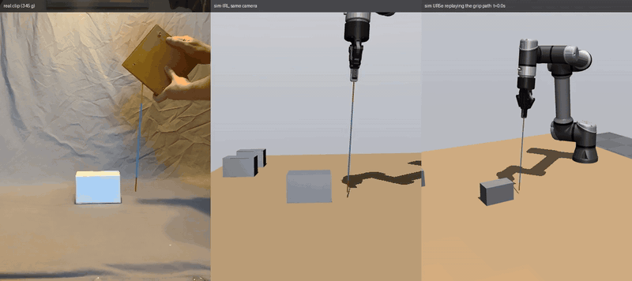
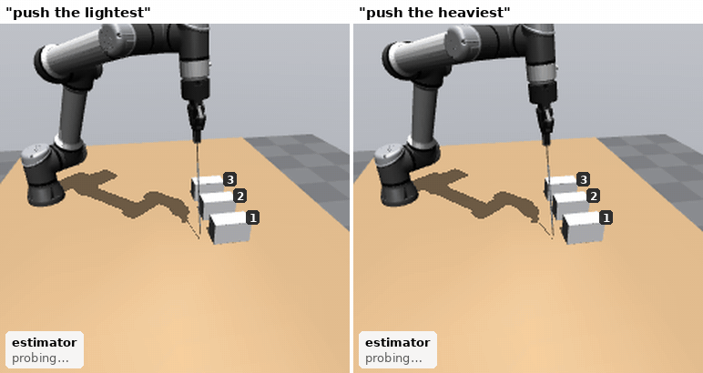
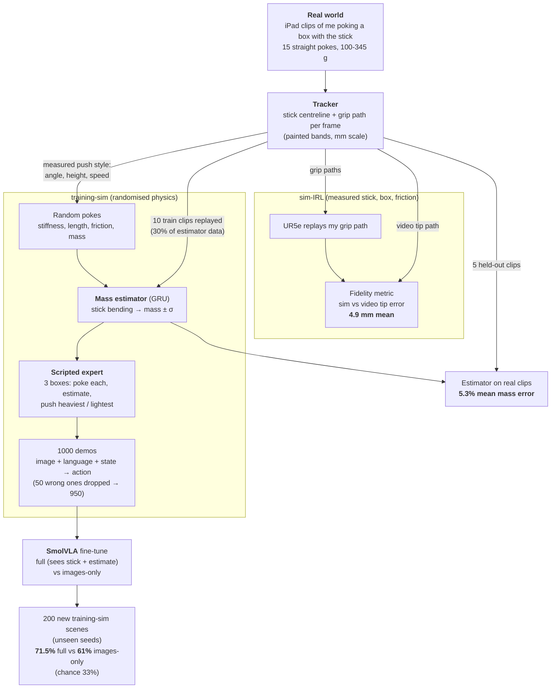

# Weighing by Poking

*Real pokes, a measured sim, and a touch signal the camera can't read*

Three boxes look identical, so the robot pokes each one with a cheap knitting needle and reads the weight from how it
bends. A camera sees a poked box move, but can't read its weight finely from that; the needle's bend can. Every number that matters
is checked against reality: the simulated needle is 4.9 mm from video of my own pokes, and on new bench pokes the
estimator picks the heaviest or lightest of three in 83% of scenes (68% counting the pokes it couldn't read; chance
33%).



*Left: my real poke (345 g box, a clip held out from training). Middle: sim-IRL from the same camera. Right: the
simulated UR5e replaying my recorded grip path.*

The mass estimator reads real clips it never saw to within 5.3%. A VLA policy that probes three boxes picks the
heaviest or lightest correctly 71.5% of the time with the touch signal, against 61% with the camera alone.

| | |
|---|---|
| Sim vs my video, stick tip position | **4.9 mm** mean error (all 15 clips replayed) |
| Mass estimator on real clips it never saw | **5.3%** mean error (5 clips, true mass inside its ±1σ band on all 5) |
| VLA picks the right box, with the touch signal | **71.5%** (chance 33%) |
| VLA picks the right box, camera only | **61%** |
| VLA with the touch signal, in sim-IRL (measured needle, real box weights) | **67%** |
| Real bench test: pick the heaviest/lightest of three new hand pokes from the estimator alone | **83%** of scenes on clean pokes, 68% on all 47 (chance 33%) |

# The Task

When interacting with the world around us, humans are able to establish the properties of objects easily by moving them or feeling them. For a robot, this is harder to do without expensive tactile sensors. Nevertheless, it's an important skill for a robot to have. Without it, a simple task such as object stacking can end very differently if it overexerts itself on a light object or stacks a heavy object onto something fragile. In this project, I investigate an approach in which a robot tentatively interacts with its environment using a flexible probe before responding to a natural language command. 

In the scene, the robotic arm has three boxes in front of it, and holds a flexible probe. The model must respond correctly to the prompt

``Choose the heaviest/lightest box``

by interacting with the boxes via the probe and observing the effects.

I used an iPad with LiDAR to record RGBD clips of myself pushing boxes from 100g to 345g. This validated a MuJoCo simulator for training a weight estimator. A GRU with an MLP head learnt in simulation to estimate box weights (with an uncertainty) from the rod's bending. A scripted expert, which pokes in the style measured from the human data and uses the estimator, then generated demonstrations that taught the VLA to probe 3 boxes and respond to the prompt.

# Results



*The final policy on two scenes it never saw. Bottom left: the estimator's reading for each box as each poke
finishes, then the policy's choice and the true masses. Boxes are numbered 1-3 from the camera.*

## Does feeling the stick help?

I evaluated the model with just images vs images and also the results of the weight estimator. When using the results of the weight estimator, which is designed specifically to measure rod curvature, it achieves better results (71.5%) than with using the imagery of the scene alone (61%). The camera-only model still beats chance, likely because it is learning from the distance moved by the box. A lighter box bends the probe less and therefore can be pushed further. 

| | Full (touch) | Camera only |
|---|---|---|
| What the policy is given | camera image, instruction, hand pose, stick bending (6 numbers), estimator's mass ± σ per box (9 numbers) | camera image, instruction, hand pose |
| **Picked the right box** | **71.5%** | **61%** |
| Poked all three boxes | 99% | 97% |
| Made a choice within 30 s | 90% | 88% |

200 episodes each, about ±3.5 points of noise; picking at random gives 33%. Both are tested in the training-sim
(randomised physics) on scenes with seeds never used in training; see "Does it hold up in sim-IRL?" for the measured
world. During probing, light boxes (<0.13 kg) moved 68 mm on average and heavy ones (>0.25 kg) 31 mm, which is the cue the camera-only model
most likely uses. In the camera image the stick itself is under 1 pixel wide.

This version was picked from the runs in "What didn't work" using the same 200 test scenes, so 71.5% is slightly
optimistic; the gaps between versions (10+ points) are well beyond the noise.

The policy follows the trained wording, not the meaning. On the same 200 scenes with instructions it never saw in
training ("push the box that weighs the least", "push the box that is hardest to move", ...), full falls from 71.5% to
36% and camera-only from 61% to 39%. Only wordings that still contain "heaviest" or "lightest" hold up ("move the
lightest-feeling box": 71%). "Push the least heavy box" makes the full policy push the *heaviest* box 52% of the
time: it reacts to the word "heavy" (`out/vla_eval/phrasings_breakdown.json`).

## Where does it break?

Sensing breaks when the target and its nearest rival are both heavier than about 170 g. On the robot's simulated
pokes, the estimator's readings flatten out above that weight (see "Does it hold up in sim-IRL?"). Splitting the same
200 episodes:

| | Episodes | Full policy | Expert's rule on the policy's own pokes | Camera only |
|---|---|---|---|---|
| Target and nearest rival both > 170 g | 62 | 65% | 71% | 63% |
| Otherwise | 138 | 75% | 96% | 60% |

- **Mass ratio barely matters outside that region.** When the pair isn't both above 170 g, the expert's rule on the
  policy's pokes is right 96-98% of the time at every ratio from 1.3× to 2.5×. Inside the region it falls to 52% at
  1.3-1.5×.
- **Camera-only is not hurt by saturation** (63% vs 60%). It reads how far the box slides, a weight cue that doesn't
  flatten out, but reads it too coarsely to follow the mass ratio.
- **Most of the loss is in the decision, not the sensing.** Applied to the policy's own pokes, the expert's simple
  rule picks right 88.5% of the time; the policy itself gets 71.5%. About 17 points are lost choosing and driving
  to the box, about 11 in sensing, three quarters of that in the saturated region.
- **The policy sometimes does the opposite of the instruction.** Of its 37 wrong picks, 17 push the opposite
  extreme: the lightest box when asked for the heaviest, or the reverse. This is why scenes with a target over 2.5×
  from its rival score only 65%: the rule is right 92% of the time there, and 6 of the policy's 7 wrong picks are
  the opposite extreme.
- **Perfect sensing doesn't close the gap.** Feeding the full policy the true weights instead of the estimator's
  (same 200 scenes) raises it only from 71.5% to 76%. With those weights the expert's rule is right 98.5% of the
  time, but the policy still makes no choice in 9.5% of scenes and picks wrong in 16% of those where it chooses.

## Does it hold up in sim-IRL?

The tests above use the randomised training-sim. Sim-IRL is one fixed world set to the real bench: my measured
needle, box friction 0.55, and each scene's three boxes drawn from my four real weights (100, 160, 230, 345 g). The
policy never trained in exactly this world. Same 200 seeds, same two policies:

| | Full, training-sim | Full, sim-IRL | Camera only, training-sim | Camera only, sim-IRL |
|---|---|---|---|---|
| **Picked the right box** | **71.5%** | **67%** | 61% | 57% |
| Poked all three boxes | 99% | 98.5% | 97% | 97.5% |
| Made a choice within 30 s | 90% | 88.5% | 88% | 91.5% |
| Expert's rule on the policy's own pokes | 88.5% | 75.5% | 83.5% | 81% |

The policy's behaviour carries over; the drop comes from sensing. On the robot's pokes the estimator reads the
160 g and 230 g boxes about 46% heavy (median), while 100 g (+13%) and 345 g (+3%) are close. That puts 230 g
almost level with 345 g, so "heaviest" (61%) suffers more than "lightest" (73%).

The expert's rule does better on the camera-only policy's pokes (81%) than on the full policy's (75.5%). Its
readings per weight are the same, though (medians within 3 g at every weight), and so are the box slides. With
about ±3 points of noise on each 200-episode figure, I don't think the gap is real.

This is not a sim-IRL effect. Running the scripted expert on the same seeds shows the same pattern in the
training-sim: the robot's simulated pokes saturate. Over-reading starts at about 130 g (130-170 g boxes read 1.35×
heavy) and is complete by about 170 g, above which every box reads 310-360 g. The cause is the simulated needle
tip, which jams on heavy boxes instead of sliding (see Limitations). Poking with a human-length stroke doesn't fix
it: with the scripted expert going 5, 6 or 7 cm past the box face instead of 9 cm, a 230 g box still reads about
320 g in sim-IRL, and nothing reads above about 355 g (100 scenes per stroke). Sim-IRL's real weights
just happen to sit in that flat region, and the training-sim's random weights mostly don't. On my real hand pokes,
where the tip doesn't jam, the same estimator is 5.3% off across 100-345 g.

## How close is the sim to reality?

I used the human videos to validate the simulation. Replaying my grip paths in sim-IRL, the simulated probe tip was on average 4.9 mm from the tip in the video, ranging from 3.0 to 7.5 mm per clip, across all 15 clips.

| Box | Clips | Tip error (mean per clip) | Peak tip deflection, video vs sim |
|---|---|---|---|
| 100 g | 3 | 4.6-5.9 mm | 23-28 vs 14-24 mm |
| 160 g | 4 | 4.1-5.3 mm | 32-38 vs 27-36 mm |
| 230 g | 1 | 6.5 mm | 44 vs 40 mm |
| 345 g | 7 | 3.0-7.5 mm | 50-69 vs 48-75 mm |

The whole stick (not just the tip) is 2.1 mm from the video on average. The sim bends too little at 100 g: the real
stick bends about 1.45x more there. Per-clip plots: `out/sim_irl/<clip>/tip_error.png`.

## Can the estimator read real pokes?

Tested on 5 real clips that were never used in training (split by clip in `data/replays/straight_split.json`):

| | Mean error | Worst clip | True mass inside ±1σ |
|---|---|---|---|
| As tracked | 15.1% | 49% (a 100 g box read as 149 g) | 3 / 5 |
| **After zeroing the stick's resting bend** | **5.3%** | 10.5% | **5 / 5** |

The real stick is never perfectly straight: it rests with a 1-6 mm bend, which the estimator read as load and which
made light boxes look heavy. Subtracting the shape from the first 0.4 s, before contact, fixed it.

## Bench test: can it pick the heaviest box from new real pokes?

Five held-out clips is a small test, so I recorded 47 new pokes: one box, filled to 100, 160, 230 and 345 g, one
video per fill with 10-13 pokes each, resetting the box between pokes. Not blinded: I knew the fill while poking.
`scripts/split_pokes.py` and `scripts/track_pokes.sh` cut each video into pokes and track them, and
`scripts/bench_report.py` reads every poke with the same estimator and settings as above (`out/bench/`).

Two kinds of poke can't be read, and I flagged them after seeing the readings:

- **Started in contact** (9 pokes): the stick came into shot already pressed against the box, so there is no
  unloaded moment to zero the rest bend from (the "still moment before the push" rule of `data/usable/README.md`).
  These read far too light.
- **No bend seen** (11 pokes): the tracker never saw the stick bend by more than 2 mm. In the 160, 230 and 345 g
  videos my navy sleeve was the same blue as the stick, which probably caused most of these. This rule also drops
  five 100 g pokes that read 90-100 g, so it is not neutral.

| Fill | All pokes: n, median estimate | Clean pokes: n, median estimate | Clean pokes within 20% |
|---|---|---|---|
| 100 g | 13, 90 g | 7, 75 g | 14% |
| 160 g | 10, 213 g | 5, 230 g | 0% |
| 230 g | 12, 140 g | 7, 218 g | 57% |
| 345 g | 12, 298 g | 8, 325 g | 88% |

The task the robot faces is a ranking, so I scored every combination of three pokes with different fills, asked both
"heaviest" and "lightest": **83%** right on clean pokes (2394 scenes), 68% on all pokes; chance is 33%. Every scene
that doesn't need 160 g told apart from 230 g scores 91-100% on clean pokes; the two that do score 36-37%.

The 160 g pokes read as heavy as the 230 g ones, but the stick itself separates them. Median peak bend on the clean
pokes is 4.0, 4.4, 6.3 and 8.7 mm for 100, 160, 230 and 345 g, with no overlap between 160 and 230 g, in the same
order as my earlier clips (4.4, 5.6, 7.6, 9.2 mm). So the labels are right (I re-weighed the 160 g fill afterwards: 160 g) and the information is there; the
sim-trained estimator doesn't use it here. I haven't found why, and I haven't retuned anything to the bench data.

# How my real data drives the sim

Every real clip goes through the tracker, which gives the stick's shape and my hand's path in millimetres. Those
drive the sim-IRL replays, set how the training-sim pokes, and supply 30% of the estimator's training data.



What comes from my data and measurements:

- **The stick and box in the sim:** measured on the bench (below).
- **How the robot pokes:** the angle (80-90°), height on the box face (2-28 mm) and speed are matched to my clips.
- **The estimator:** 30% of its training pokes follow my real recorded grip paths.
- **The check:** replaying my grip paths in sim-IRL and comparing the stick with the video.

What does not: the three-box layout, the expert's decision rule, stick damping (never measured), and the policy's
camera, which is a rendered view rather than my iPad's.

# Pipeline

## 1. Recording and tracking

I hold a stick perpendicular to the ground which has measured painted bands. I approach a weighted box and push it with the stick.

- **The stick:** a 3 mm aluminium knitting needle wrapped in masking tape, 334 mm free length, painted in
  bands (yellow 69 mm, blue 225 mm, orange tip 40 mm), clamped in a wooden block that I hold. Hanging weights from
  the tip gave its bending stiffness: 0.31 N·m², about 40 mm of tip deflection per newton.
- **The box:** 129 × 69 × 80 mm, filled to 100, 160, 230 and 345 g. A tilt test gave a friction coefficient of 0.55.
- **Recording:** an iPad on a tripod, side-on to the push (Stray Scanner: RGB, LiDAR depth and camera pose).
- **Tracking:** colour masks find the bands in every frame, giving the stick's centreline in millimetres and the
  path of my hand. Clips were sorted into usable tiers (`data/usable/README.md`): 15 straight pokes are used.

## 2. Sim-IRL: replaying my pokes

I use a cable plugin in MuJoCo to simulate a stiff but flexible probe stick. I use measured values for the probe in simulation: length 334 mm, radius 1.75 mm and Young's modulus 4.2 × 10¹⁰ Pa (from the bending stiffness above). I replay the grip from the real world in simulation, and score how close the probe is to the real world value.

The box uses its recorded mass and size, and friction 0.55. MuJoCo 3.14.0; a UR5e with a Robotiq gripper holds the stick.
Replaying with friction from 0.45 to 1.0 also matched the video best at 0.55, which agrees with the tilt test.

## 3. Training-sim and the mass estimator

I use a data set that is 30% real-path replays, and 70% generated data, both with randomised physics. With a GRU I train the model to estimate the weight of the box based on the curvature of the probe. 

- **Randomised around the measurements:** Young's modulus 3-6 × 10¹⁰ Pa, length 320-350 mm, friction 0.45-0.65, box mass
  60-450 g, poke angle 80-90°, speed 20-100 mm/s.
- **Data:** 5000 simulated pokes. 30% of them replay my real grip paths from the 10 training clips only.
- **Output:** log-mass with an uncertainty (σ), so the expert can tell a confident reading from a guess.

## 4. Expert demonstrations

An expert pokes 3 boxes. Over 1000 demos, it decides to push either the heaviest or the lightest box. 

The expert is a script, not a learned model. It pokes the boxes left to right, runs the estimator after each poke,
picks the box most likely to be the heaviest (or lightest) given the estimates and their σ, and pushes it 14 cm.
Each scene has three identical-looking boxes (70-450 g, at least 1.3× apart), a random instruction sentence, and
randomised stick and friction. The expert was right in 95% of the 1000 demos; the 50 wrong ones were removed before
training, which turned out to matter more than anything else (see below).

## 5. Fine-tuning SmolVLA

- **Model:** SmolVLA (450M parameters, ~100M trained), LeRobot 0.6.1, on one RTX 4070 Ti (12 GB).
- **Input:** one 256 × 256 camera image, the instruction, and the state: 22 numbers for Full, 7 for camera-only.
- **Output:** the next 50 hand targets (3.3 s), executed before the next prediction.
- **Training:** 20k steps (batch 16), then 10k more on the cleaned demos.

# What didn't work

| Change | Success (Full) | What I learned |
|---|---|---|
| Angled pokes (stick at ~33-45°) | n/a | The tip caught on the box, so the bend was inconsistent for the same mass. Straight pokes were tight per mass. |
| v1: first straight-poke policy | 50.5% | A third of the time it hovered between boxes until the 30 s timeout. |
| v1, re-planning every 0.7 s instead of 3.3 s | 39.5% | It stopped hovering but chose worse: the long open-loop moves had been hiding a weak decision. |
| v2: shuffled poke order + recovery demos | 40% | More varied demos made even the poking worse (25.5% at half the training). |
| **v3: v1's demos minus the expert's 50 wrong ones** | **71.5%** | The policy had been copying the expert's mistakes. |
| v4: v3, but 30% of the expert's pokes are replays of my real pokes | 58.5% (camera only 33.5%) | Shortening the chain from my clips to the policy cost 13 points. My real pokes are gentler (5-7 cm past the box face, against 9 cm scripted), so heavy boxes read noisier: 0.22-0.39 kg for a 0.337 kg box, against 0.35 kg scripted. The policy learned the softer poking: the expert's rule on its own pokes fell from 88.5% to 79%. |
| Estimator before zeroing the resting bend | 15.1% error | See "Can the estimator read real pokes?". |

# Limitations

- **The VLA is only tested in simulation,** in the randomised training-sim and the measured sim-IRL (67%), not on a
  real robot. The robot's simulated pokes over-read from about 130 g and can't tell weights above about 170 g
  apart (the tip jams), which caps "heaviest" in both sims.
- **Friction has to be known.** The needle reads the box's resistance, friction × weight. The estimator is given the
  friction (measured 0.55 on my bench) and all three boxes share it, so a wrong value shifts all three estimates
  together and the ranking survives. Boxes with different surface friction are not covered.
- **The sim is not trustworthy everywhere:** it bends about 1.45× too little at 100 g, and the simulated tip grips
  the box harder than the real one, so heavier straight pokes jam instead of sliding (see above). Replays of my
  real grip paths don't jam, even at 345 g.
- **The policy matches keywords, not meaning:** unseen wordings drop it from 71.5% to 36%, and "least heavy" makes it
  push the heaviest box (see Results). Its training data used four phrasings per goal.
- **The real-world decision test is the estimator alone,** not the VLA, and it can't tell 160 g from 230 g. It was
  unblinded, one video per fill, so anything that drifted within a video is mixed up with weight, and the flags were
  applied after seeing the readings.
- **Small real dataset:** 15 straight-poke clips plus 47 bench pokes, one stick, one box, one table.
- **Not from my data:** the three-box task, the decision rule and the policy's camera view.

# Reproduce

Two environments: `.venv` (MuJoCo 3.14.0, `requirements.txt`) for the sim and estimator, and `.venv-vla`
(`lerobot[smolvla]==0.6.1`, CUDA) for the VLA. Raw videos, datasets and checkpoints are not in the repository.

```bash
# track a clip (camera once per tripod setup)
python scripts/camera_from_stray.py data/raw/<clip> --anchor-px U V --axis-px U2 V2
python scripts/track_video.py data/raw/<clip> --label free --mass 0.345 --out data/runs/real/<clip>.npz

# sim-IRL: replay my grip paths and score against the video
MUJOCO_GL=egl python scripts/replay_real.py data/usable/straight_*/*/track.npz --out out/sim_irl

# train the estimator (5000 pokes), then test it on the held-out real clips
scripts/launch_estimator.sh 5000 --style straight
python scripts/estimate_real.py data/runs/real/<test clips>.npz --ckpt checkpoints/estimator/<run>/best.pt

# bench test: split a long video into pokes, track them, read them
#   (--frame 30: calibrate from a frame where the box sits alone; --body-v 0.55 when a dark-blue sleeve is in shot)
python scripts/camera_from_stray.py data/raw/bench/230g --anchor-px U V --frame 30
python scripts/split_pokes.py data/raw/bench/230g --body-v 0.55 --out data/raw/bench/230g/pokes.json
scripts/track_pokes.sh data/raw/bench/230g 230g 0.230 --body-v 0.55
python scripts/bench_report.py data/runs/real/bench/*_p*.npz --out out/bench

# expert demos -> fine-tune -> evaluate (the full v3 recipe)
scripts/vla_straight_v3.sh
# same policy in sim-IRL (measured needle and friction, the real box weights)
python scripts/eval_vla.py --policy outputs/vla/straight_v3_full/checkpoints/last/pretrained_model \
  --n 200 --style straight --world sim-irl --out out/vla_eval/straight_v3_full_simirl
# both v3 policies on instructions never seen in training
scripts/vla_eval_v3_phrasings.sh
```

# Repo layout

```
probe/      importable logic: stick, scene, control, rollout, tracker, estimator, simdata (training-sim),
            multibox (3-box task + expert), calibration, camera, arkit, geometry, features, schema, io
scripts/    one job each: tracking, replay, estimator training/testing, bench test (split_pokes, track_pokes,
            bench_report), VLA data/eval, launch scripts (vla_*.sh)
tests/      pytest: cantilever vs Euler-Bernoulli, rigid attachment, extraction, tracker, rest-shape zeroing
models/     generated MJCF
data/       usable/ (triaged real clips), replays/ (train/test split + grip paths), runs/real/ (tracked clips,
            bench/ for the bench pokes), raw/bench/ (bench videos + pokes.json)
out/        sim_irl/ (replay scores), estimator_straight/, bench/, vla_eval/, gif/
archive/    the first README and its outputs, the angled-poke VLA (heaviest_v1), one-off run launchers
```
