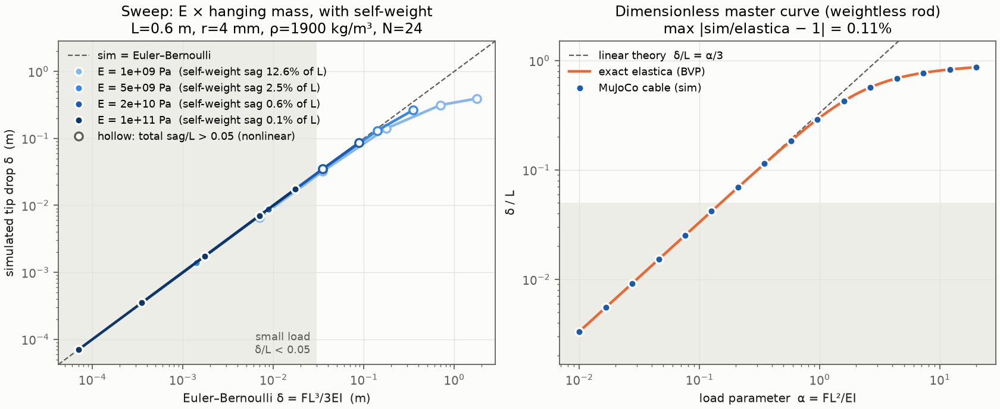

# Compliant-probe world model

A flexible stick held in the hand bows when it pushes on things. A cantilever's curvature measures the
applied moment, M(s) = EI·κ(s), so the bend works as a force sensor, and its signature over a push says
what was poked: something bolted down, something heavy, or something light. This repo reproduces the
setup in MuJoCo. A UR5e replaces the hand, the stick is an elastic rod, and the flange follows the grip
trajectory tracked from video. **The stick tip is never driven.** Its position is a held-out prediction, and
sim-vs-video tip error (mm) is the fidelity metric for the simulator as a world model.

Status: runs end-to-end on synthetic grip trajectories. Real video drops in through
[the data contract](docs/data_contract.md). Design decisions and evidence are in [design notes](docs/design_notes.md).



## Setup

```bash
python -m venv .venv && .venv/bin/pip install -r requirements.txt   # pins mujoco 3.14
git clone --depth 1 https://github.com/google-deepmind/mujoco_menagerie third_party/mujoco_menagerie
.venv/bin/python -m pytest
```

## Pipeline

```bash
python scripts/calibrate.py                         # beam validation, out/calibration.png, probe/calibration.json
python scripts/calibrate.py --measure 0.05 0.031    # E from a bench measurement: mass (kg), tip drop (m)
python scripts/make_synthetic_trajectory.py         # data/trajectories/synthetic_push.csv
python scripts/run_probe.py --trajectory data/trajectories/synthetic_push.csv --object fixed --out data/runs/fixed.npz
python scripts/render.py   --trajectory data/trajectories/synthetic_push.csv --object fixed --out out/fixed.mp4
python scripts/compare.py data/runs/a.npz data/runs/b.npz --out out/compare
python scripts/classify.py --per-class 25 --workers 16
python scripts/classify.py --reuse --real data/runs/real          # train on sim, test on video observations
python scripts/camera_from_stray.py data/raw/clip01 --anchor-px U V --axis-px U2 V2   # real camera -> sim
python scripts/discretisation_study.py                            # cantilever error vs segment count
```

Bench protocol for E: clamp the stick horizontally at the grip, note the tip height, hang a mass at the
tip, and note the tip drop δ. Then run `young_from_deflection(mass, δ, length, radius)`, adding `--self-weight` / `density=` if the stick
sags noticeably under its own weight.

## Layout

```
probe/      importable logic: stick, calibration, scene, control, rollout, geometry, features, schema, io, residual
scripts/    thin CLIs, one job each
tests/      pytest: cantilever vs Euler-Bernoulli, rigid attachment, extraction, contract, end-to-end
models/     generated MJCF (scene.xml, cantilever.xml)
data/       raw/ (video), trajectories/ (grip CSVs), runs/ (observations .npz)
out/        figures, renders
docs/       data contract, design notes
```
